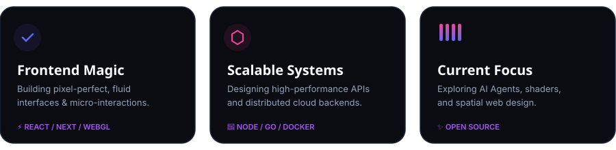

  <!-- 🌌 ANIMATED CUSTOM SVG HERO -->
  

   

  <!-- ⌨️ GOOGLE FONT ANIMATED TYPING SVG -->
  

    

  <!-- 🔗 MODERN PILL SOCIAL LINKS -->
  

    &nbsp;&nbsp;
    &nbsp;&nbsp;
    &nbsp;&nbsp;
    
  

   

  <!-- 🍱 BENTO GRID CUSTOM SVG -->
  

 

<!-- ⚡ TECH ARSENAL SECTION -->

  
  

    
  

  

<!-- 🚀 FEATURED PROJECTS (GLASSMORPHIC MATRIX TABLE) -->

  

<table align="center" width="100%">
  <tr>
    <td width="50%" valign="top">
      <h3 align="left">✨ Nebula UI Engine</h3>
      
A zero-runtime, WebGL-powered component library featuring fluid physics and glassmorphic primitives for modern web apps.

      

        
        
        
      

      

        <a href="https://github.com/YOUR_GITHUB_USERNAME"><b>↗ View Repository</b></a> &nbsp;|&nbsp; <a href="https://your-demo-link.com"><b>⚡ Live Demo</b></a>
      

    </td>
    <td width="50%" valign="top">
      <h3 align="left">🧠 Synapse AI Studio</h3>
      
Autonomous multi-agent workflow builder with real-time streaming node graphs, vector memory, and custom LLM routing.

      

        
        
        
      

      

        <a href="https://github.com/YOUR_GITHUB_USERNAME"><b>↗ View Repository</b></a> &nbsp;|&nbsp; <a href="https://your-demo-link.com"><b>⚡ Live Demo</b></a>
      

    </td>
  </tr>
</table>

  

<!-- 📊 IMMERSIVE TELEMETRY & GITHUB STATS -->

  
  
   

  <!-- Streak & Stats Side-by-Side -->
  

    
    
  

  <!-- Animated Activity Graph -->
  

 

<!-- 🌊 ANIMATED LIQUID WAVE FOOTER -->

  

