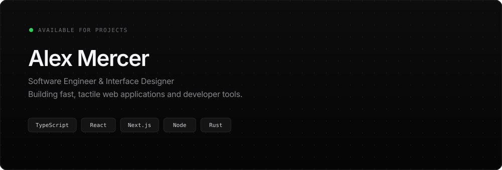

 

  <a href="https://yourwebsite.com"><b>Website</b></a> &nbsp;·&nbsp;
  <a href="https://x.com/yourusername"><b>X / Twitter</b></a> &nbsp;·&nbsp;
  <a href="https://linkedin.com/in/yourusername"><b>LinkedIn</b></a> &nbsp;·&nbsp;
  <a href="mailto:you@domain.com"><b>Email</b></a>

 

### Selected Work

Click any project below to expand architecture details and links.

  
<b>01 — Raycast / Linear Style Command Menu</b> &nbsp;<code>TypeScript</code> <code>React</code> <code>Zero-Dependency</code>

   
  <blockquote>
    A composable, accessible command palette with fuzzy search, keyboard navigation, and spring-physics transitions under 4kB gzipped.
      
    <a href="https://github.com/yourusername/project-1">View Repository →</a> &nbsp;·&nbsp; <a href="https://yourdemo.com">Live Demo ↗</a>
  </blockquote>

  
<b>02 — Distributed Rate Limiter & API Gateway</b> &nbsp;<code>Go</code> <code>Redis</code> <code>Docker</code>

   
  <blockquote>
    High-throughput token-bucket rate limiter handling 50k+ req/sec with sub-millisecond Redis Lua script evaluation and automatic failover.
      
    <a href="https://github.com/yourusername/project-2">View Repository →</a>
  </blockquote>

  
<b>03 — WebGL Shader & Noise Studio</b> &nbsp;<code>GLSL</code> <code>WebGL2</code> <code>Canvas</code>

   
  <blockquote>
    Real-time procedural gradient and simplex-noise generator that exports clean, copy-pasteable CSS and SVG filters for web designers.
      
    <a href="https://github.com/yourusername/project-3">View Repository →</a> &nbsp;·&nbsp; <a href="https://yourdemo.com">Live Demo ↗</a>
  </blockquote>

 

### Writing & Notes

* **[Designing Tactile Interfaces on the Web](https://yourwebsite.com)** — *How spring physics and subtle audio cues make web apps feel physical.*
* **[Why We Replaced Our ORM with Raw SQL](https://yourwebsite.com)** — *Cutting p99 query latency by 68% in production.*
