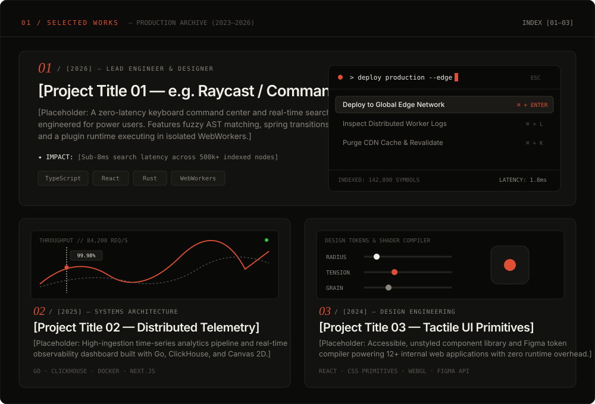
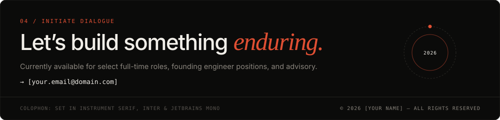

<!-- ==================== 01. HERO & NAVIGATION ==================== -->

  
    <a href="https://your-portfolio-website.com"><b>↗ LIVE WEBSITE</b></a> &nbsp;&nbsp;·&nbsp;&nbsp;
    <a href="https://your-resume-link.pdf"><b>↓ RESUME (PDF)</b></a> &nbsp;&nbsp;·&nbsp;&nbsp;
    <a href="https://github.com/yourusername"><b>GITHUB</b></a> &nbsp;&nbsp;·&nbsp;&nbsp;
    <a href="https://linkedin.com/in/yourusername"><b>LINKEDIN</b></a> &nbsp;&nbsp;·&nbsp;&nbsp;
    <a href="https://x.com/yourusername"><b>X (TWITTER)</b></a> &nbsp;&nbsp;·&nbsp;&nbsp;
    <a href="mailto:your.email@domain.com"><b>EMAIL</b></a>
  

 

<!-- ==================== 02. SELECTED WORKS ==================== -->

<table width="100%">
  <tr>
    <td width="33%" align="center">
      <b>01 · [PROJECT TITLE 01]</b> 
      <a href="https://github.com/yourusername/project-1">Source Code ↗</a> &nbsp;·&nbsp; <a href="https://demo-1.com">Live Demo ↗</a>
    </td>
    <td width="33%" align="center">
      <b>02 · [PROJECT TITLE 02]</b> 
      <a href="https://github.com/yourusername/project-2">Source Code ↗</a> &nbsp;·&nbsp; <a href="https://demo-2.com">Live Demo ↗</a>
    </td>
    <td width="33%" align="center">
      <b>03 · [PROJECT TITLE 03]</b> 
      <a href="https://github.com/yourusername/project-3">Source Code ↗</a> &nbsp;·&nbsp; <a href="https://demo-3.com">Live Demo ↗</a>
    </td>
  </tr>
</table>

 

<!-- ==================== 03. EXPERIENCE & STACK ==================== -->

  

<!-- ==================== 04. FOOTER & COLOPHON ==================== -->

